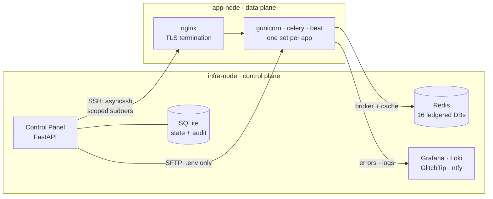
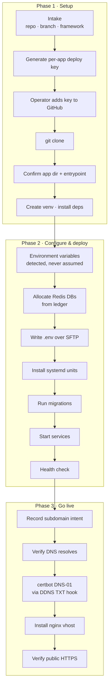
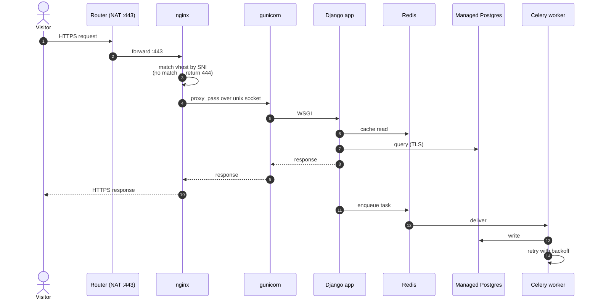
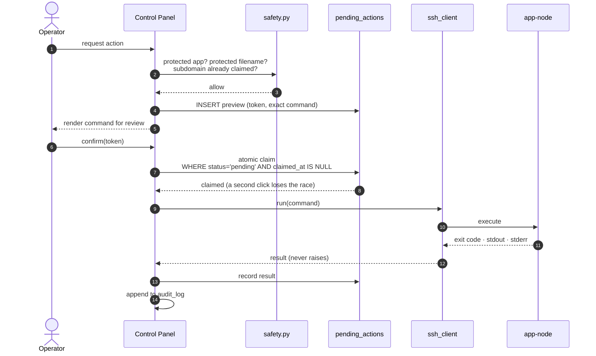
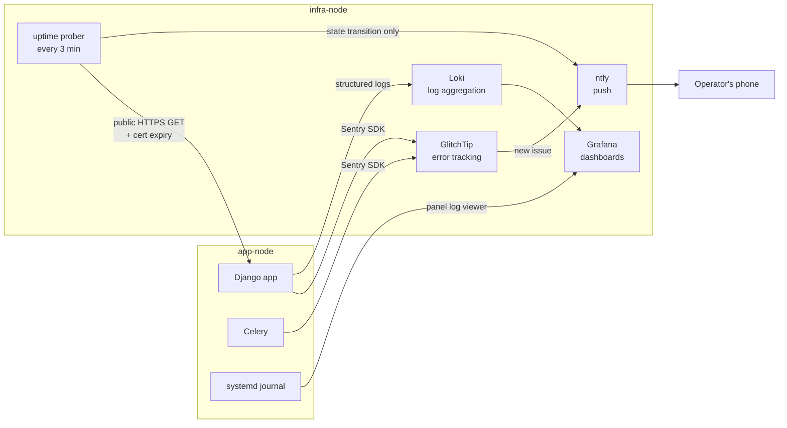

# Homelab Control Plane

**A self-hosted PaaS for a home server.** Point it at a Git repository and it will provision a Python
web application end to end — clone, virtualenv, dependencies, environment, Redis allocation, systemd
units, database migrations, dynamic DNS, a Let's Encrypt certificate and an nginx vhost — and leave you
with a working `https://` URL.

Think "Render or Railway, but the hardware is in my house and I wrote the control plane."

<p>


</p>

> **About this repository.** This is a sanitised, portfolio-facing extract of a running private homelab.
> Every hostname, IP address, domain, credential and project name has been replaced with a placeholder —
> see [Sanitisation](#sanitisation). The architecture, code and engineering history are real.

---

## Contents

- [Why this exists](#why-this-exists)
- [Architecture](#architecture)
- [The two nodes](#the-two-nodes)
- [How a deployment happens](#how-a-deployment-happens)
- [The request path](#the-request-path)
- [Safety model: preview → confirm → execute](#safety-model-preview--confirm--execute)
- [Security model](#security-model)
- [Observability](#observability)
- [Scheduled reconciliation](#scheduled-reconciliation)
- [Engineering log: bugs that taught me something](#engineering-log-bugs-that-taught-me-something)
- [Repository layout](#repository-layout)
- [Tech stack](#tech-stack)
- [Known gaps](#known-gaps)
- [Sanitisation](#sanitisation)

---

## Why this exists

I host several Django applications on a home server. Doing that by hand means SSH-ing in, cloning a
repo, building a virtualenv, hand-writing a systemd unit, remembering which Redis database is already
taken, hand-editing an nginx vhost, running `certbot` with the right challenge type, and hoping the
dynamic DNS record still points at the right place.

Every one of those steps is a place to make a silent mistake. Several of them *did* go wrong, and the
resulting outages are what shaped this tool. The goal was never "automate deployment" in the abstract —
it was **remove the specific classes of mistake that had already bitten me**, and make every remaining
privileged action reviewable before it runs.

**Design principles**, in the order they actually mattered:

| Principle | What it means in practice |
| --- | --- |
| **Nothing runs unreviewed** | Every mutating action renders the exact command first and waits for explicit confirmation. |
| **Ask, don't guess** | Auto-detection was *removed* twice after it inferred the wrong thing. The tool lists real options; a human picks. |
| **Separate the control plane** | The deploy tool runs on a different VM from the apps it deploys, so a bad deploy can't kill the deployer. |
| **Least privilege, enforced twice** | Scoped `sudoers` on the target host *and* an application-level denylist, because a `sudo` wildcard can't tell one app from another. |
| **State lives in one place** | A single SQLite database is the source of truth; the filesystem is treated as a projection of it. |

---

## Architecture


Two virtual machines on one hypervisor, with a deliberate split:



The important edge is `PANEL --> app-node`. It is the **only** way the control plane touches the data
plane, it goes through a single module (`app/ssh_client.py`), and it authenticates with one dedicated
key that has a narrowly scoped `sudoers` grant on the far side.

---

## The two nodes

| | **app-node** (data plane) | **infra-node** (control plane) |
| --- | --- | --- |
| **Role** | Serves public traffic | Orchestrates, observes, reconciles |
| **Internet-facing** | Yes — via one forwarded `:443` | No |
| **Web tier** | nginx (TLS, vhost per app, catch-all `444`) | uvicorn on a LAN-only bind |
| **App tier** | gunicorn (2 workers, gthread, unix socket) | — |
| **Async tier** | celery worker + celery beat per app | — |
| **Data** | app code, venvs, static files, `.env` (0600) | SQLite state, encrypted secrets, Redis |
| **Managed by** | the control panel, over SSH | systemd (`Restart=always`) + timers |

Applications live at `/srv/apps/<app>/` and are driven by systemd. The original units were true
template units (`gunicorn@.service`, using `%i`); the panel now generates **concrete** per-app units
instead — see [Design decisions](docs/DESIGN-DECISIONS.md#concrete-units-over-template-units) for why
that mattered.

---

## How a deployment happens

Onboarding is a three-phase wizard. Every step is resumable, most are re-runnable, and the two that
structurally can't be (a clone into a non-empty directory, a Redis allocation that already happened)
have explicit undo actions.



Two details worth calling out:

**Environment variable *names* are discovered per-repository, never assumed.** One real repository used
`DJANGO_ALLOWED_HOSTS` where another used `ALLOWED_HOSTS`. Writing the wrong name doesn't raise an
error — the framework silently falls back to its own default, which is exactly how you end up debugging
a `400 DisallowedHost` in production. The tool parses the repo's own `.env.example`, records which names
*that* project uses, and writes those.

**The certificate is issued over DNS-01, not HTTP-01,** because the ISP blocks inbound `:80`. The
challenge is fully automated: a hook script publishes the TXT record via the DDNS provider's API, polls
two independent public resolvers until *both* agree the record is visible, waits out a grace period, and
only then lets the ACME validation proceed. That two-resolver requirement was not paranoia — see
[incident #1](docs/INCIDENTS.md#1-dns-01-validation-and-the-stale-secondary-resolver).

---

## The request path



The unix socket rather than a TCP port is deliberate: it means an app is reachable *only* through nginx,
with filesystem permissions as the access control. `RuntimeDirectoryPreserve=yes` on the unit keeps
`/run/gunicorn/` alive across restarts — omitting it once deleted the socket directory mid-restart and
took every app on the box down at the same time.

---

## Safety model: preview → confirm → execute

No mutating action executes directly from a request handler. Every one becomes a row in a
`pending_actions` table first, rendered to the operator as the literal command that will run.



Three properties this buys:

1. **Commands are built server-side** from validated enum and database values — never from request text.
2. **Double-submits can't double-execute.** The claim is atomic. This mattered because certificate
   issuance takes 40–60 seconds with no progress indicator, which invites an impatient second click.
3. **Secrets never enter the audit trail.** Writing an `.env` is the one action that isn't a shell
   command at all: the preview shows *variable names only*, and the real content is decrypted in memory
   and delivered over SFTP. A decrypted secret is never interpolated into a command string.

---

## Security model

Full detail in [docs/SECURITY-MODEL.md](docs/SECURITY-MODEL.md). The short version:

| Concern | Approach |
| --- | --- |
| **Blast radius of the SSH key** | The orchestrator key's `sudoers` grant is an explicit allowlist of `systemctl`/`nginx -t`/`certbot`/scoped `cp` commands. No blanket root, no shell. |
| **`sudo` wildcards can't distinguish apps** | `systemctl stop gunicorn@*` matches every app, so an application-layer denylist (`safety.py`) refuses protected apps *before* a command is built. |
| **Writing into root-owned directories** | The deploy user writes to a staging directory it owns; `sudoers` permits `cp` *only* from that exact path into the system directories. |
| **Secrets at rest** | Fernet-encrypted in SQLite, keyed from the panel's own environment. Ciphertext is what's stored; plaintext exists only in memory during a write. |
| **Secrets in transit** | SFTP to a `0600` file. Never a command argument, never in `pending_actions`, never in `audit_log`. |
| **Certificate private keys** | `/etc/letsencrypt/` is root-only `0700`. The deploy user cannot read it — not even to test existence — so the panel tracks expiry from `certbot`'s own output instead of probing the filesystem. |
| **Shell injection via config values** | Every `.env` value is `shlex.quote()`-wrapped. A real connection string containing `&` was silently truncated at that character the first time something `source`d the file. |
| **Exposure** | The panel binds to a LAN address only, requires session auth, and hashes passwords with bcrypt. |

---

## Observability

Per-application, opt-in — not every app needs it.



Enabling observability for an app creates its GlitchTip project via API, grants it a dedicated ntfy
topic, and injects the shared Loki push credentials — then reports a **three-state** comparison between
what's saved and what's actually deployed (`in_sync` / `saved_not_deployed` / `deployed_but_different`).
That third state is not hypothetical; it caught a hand-edited value on disk that matched neither.

Alerting is transition-based, not level-based: it notifies on up→down and down→up after a failure
threshold, deduplicated by last-alerted state, so a persistent outage doesn't page every three minutes.

---

## Scheduled reconciliation

Three `oneshot` services on timers, each of which derives its work from the database rather than a
hand-maintained list — the difference that fixed a real outage.

| Timer | Interval | What it reconciles |
| --- | --- | --- |
| `ddns` | 5 min | Points every managed app's subdomain at the current WAN IP. |
| `uptime` | 3 min | Probes each public URL, records latency/status, tracks cert days remaining. |
| `renew` | daily | Renews certificates approaching expiry, with a randomised delay. |

The DDNS updater exists because the original setup used a hand-typed domain list in a cron script. When
the ISP rotated the WAN IP, the apps *in* that list followed it and the apps that had never been added
stayed pointed at a dead address. Nothing was broken on the server; the DNS was simply stale. Deriving
the domain set from the projects table means a newly onboarded app is maintained automatically —
[incident #4](docs/INCIDENTS.md#4-dns-drift-between-a-hand-typed-list-and-reality).

---

## Engineering log: bugs that taught me something

The full write-ups are in [docs/INCIDENTS.md](docs/INCIDENTS.md). Each is a real failure against real
infrastructure, with the root cause and the fix.

| # | Failure | Root cause | Lesson |
| --- | --- | --- | --- |
| 1 | ACME validation failed with a *stale* TXT record | Let's Encrypt validates from multiple vantage points; the DNS provider's nodes hadn't converged | One resolver's view of DNS is not "DNS" |
| 2 | Celery couldn't reach its broker; fell back to a default | Duplicate keys in `.env`; `EnvironmentFile` honours the **last** occurrence | Recurring class — fixed three times before the root cause was properly generalised |
| 3 | App connected to `localhost` instead of the real database | Config value truncated at an `&` when the file was `source`d | Quote every generated value |
| 4 | Two apps unreachable, all services healthy | DNS drift — hand-maintained domain list | Derive reconciliation input from state, never from a parallel list |
| 5 | A live app silently regressed to an earlier setup step | Wizard finalisers did unguarded `UPDATE ... SET step = <literal>` | Monotonic state transitions need a helper, not discipline |
| 6 | Redis index allocated outside the configured range | Allocator was `MAX(index)+1` with no awareness of the server's limit | Then the fix broke callers assuming consecutive indices |
| 7 | Cert deletion fired for a certificate that never existed | Used "a subdomain was recorded" as a proxy for "a certificate exists" | Pick the field that's only set by the event you care about |
| 8 | A vendor API credential was silently replaced with random bytes | `(^\|_)SECRET_KEY$` also matches `STRIPE_SECRET_KEY` | Test allowlist regexes against real vendor names |
| 9 | Scheduler crash-looped; login returned 500 | Managed-database compute quota exhausted by a 5-second scheduler poll | A DB-backed scheduler is a continuous load, not an idle one |

Number 9 is the most recent and the most instructive: the database-backed Celery scheduler polls
Postgres every five seconds forever. Against a serverless Postgres that bills by compute-time and
autosuspends when idle, that poll interval *is* the bill — it prevents the database from ever idling.
The fix is to raise the poll interval so the database can suspend between checks; the deeper lesson is
that "idle" in one component's model can be "continuously busy" in another's.

---

## Repository layout

```
.
├── control-panel/              # the orchestrator (sanitised source, ~5.6k LOC)
│   ├── app/
│   │   ├── main.py             # FastAPI app, router mounting
│   │   ├── config.py           # settings from environment
│   │   ├── db.py               # schema + idempotent migrations + Redis ledger allocator
│   │   ├── auth.py             # session cookies, bcrypt
│   │   ├── crypto.py           # Fernet encrypt/decrypt for secrets at rest
│   │   ├── ssh_client.py       # the ONLY module that opens SSH; never raises
│   │   ├── actions.py          # preview → confirm → execute pipeline
│   │   ├── safety.py           # protected-app / protected-filename denylist
│   │   ├── onboarding.py       # wizard business logic (the big one)
│   │   ├── dns_cert.py         # DNS check, DNS-01 issuance, nginx install
│   │   ├── lifecycle.py        # pause / resume / recommission / delete
│   │   ├── decommission.py     # ordered shutdown sequence
│   │   ├── deploy_plan.py      # push-to-deploy with commit preview
│   │   ├── observability.py    # per-app GlitchTip / Loki / ntfy wiring
│   │   ├── ddns.py             # oneshot: reconcile DNS from state
│   │   ├── uptime.py           # oneshot: probe public URLs, alert on transition
│   │   ├── renewal.py          # oneshot: certificate renewal
│   │   ├── metrics.py          # per-unit memory / restarts / uptime
│   │   ├── deploy_templates.py # renders systemd + nginx from Jinja
│   │   ├── unit_templates/     # the Jinja templates themselves
│   │   ├── routers/            # one module per route group
│   │   └── templates/          # server-rendered HTML (htmx, no SPA)
│   ├── deploy/                 # the panel's own systemd units + timers
│   └── .env.example            # every setting, no values
├── docs/
│   ├── ARCHITECTURE.md         # component-by-component deep dive
│   ├── DESIGN-DECISIONS.md     # ADR-style: what was chosen and what was rejected
│   ├── SECURITY-MODEL.md       # privilege boundaries, secret handling
│   ├── INCIDENTS.md            # nine real failures, root-caused
│   └── diagrams/
└── examples/                   # redacted real artefacts
    ├── systemd/                # unit + timer files
    ├── nginx/                  # vhost and catch-all
    ├── sudoers.d/              # the scoped privilege grant
    └── observability/          # Docker Compose stack
```

---

## Tech stack

| Layer | Choice | Why |
| --- | --- | --- |
| Orchestrator | FastAPI + Jinja2 + htmx | Server-rendered; no build step, no SPA to maintain for a single-operator tool |
| State | SQLite | One file, one writer, trivial backup; correct for this scale |
| Remote execution | `asyncssh` | Async SSH + SFTP in one library, no shelling out to `ssh` |
| Secrets | `cryptography` (Fernet) | Authenticated symmetric encryption at rest |
| Process supervision | systemd | Already the init system; templated units, restart policy, journal |
| Web tier | nginx + gunicorn over unix sockets | Apps unreachable except through the proxy |
| Async | Celery + Redis | Shared Redis, one ledgered DB index per role per app |
| TLS | Let's Encrypt via DNS-01 | Inbound `:80` is blocked by the ISP |
| Observability | Grafana · Loki · GlitchTip · ntfy | Self-hosted, Sentry-compatible SDK, push to phone |
| Virtualisation | Proxmox VE | Snapshots before risky changes |

---

## Known gaps

Listed because a portfolio that only shows the wins isn't useful.

- **`DEBUG` is not automatically turned off.** The `.env` builder hard-codes `DEBUG=True`, with a
  comment saying the flip belongs at the end of the go-live phase once HTTPS is verified. That flip was
  never implemented, so apps that *are* live still run with debug enabled. Found while writing this
  README; it is the top item on the list.
- **The log viewer polls, it doesn't stream.** A 4-second `journalctl` snapshot over SSH. Real streaming
  needs WebSocket infrastructure that doesn't exist here.
- **Single points of failure everywhere.** One hypervisor, one router, one WAN IP. This is a homelab,
  not a resilient production system, and it's deliberately not pretending otherwise.
- **FastAPI support is unit-tested, not battle-tested.** The framework-specific code paths are verified
  by rendering and unit tests; no FastAPI app has actually been onboarded end to end.
- **Managed-database compute quota is a hard ceiling.** Reducing scheduler polling helps a lot but
  doesn't remove the cap; the real fix is a paid tier or self-hosted Postgres.

---

## Sanitisation

This repository is generated from the private original by an automated rewriting pass, then verified
with a leak scan that greps the output for every original identifier.

| Real value | Placeholder here |
| --- | --- |
| Hostnames | `app-node`, `infra-node` |
| Private addresses | `10.10.0.0/24` |
| Public addresses | RFC 5737 documentation ranges (`203.0.113.x`) |
| Application names | `primary-store`, `app-alpha`, `app-beta`, `app-gamma` |
| Domains | `<app>.duckdns.org` |
| Database host | `ep-example-pooler.REGION.aws.neon.tech` |
| OS user | `deploy` |
| Email, org, team, repo owner | `operator@example.com`, `example-org`, `platform-team`, `example-user` |

No credential, token, key, certificate or connection string is present in this repository in any form.
`.env`, the SQLite database, logs and virtualenvs are excluded outright rather than redacted.

---

## License

MIT — see [LICENSE](LICENSE).
