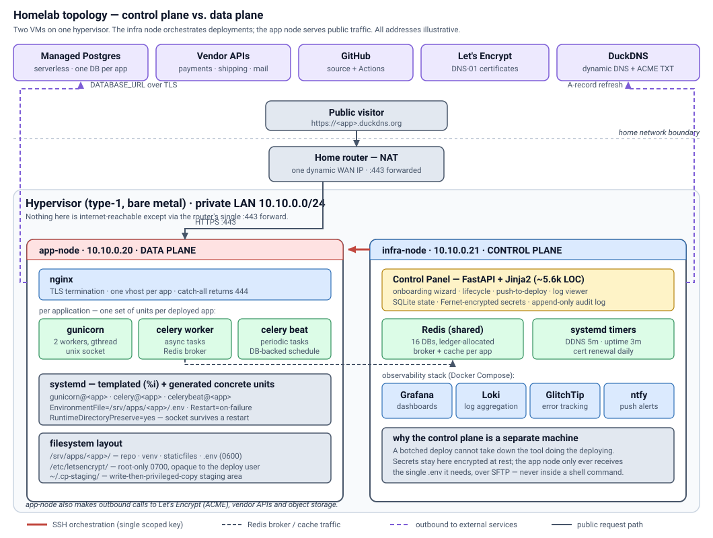
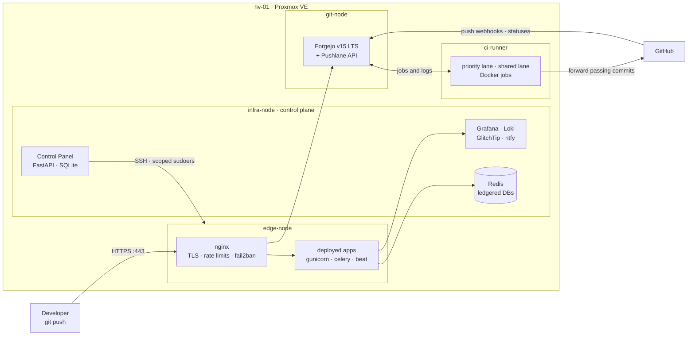
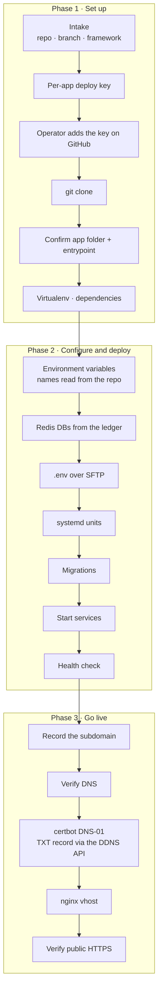
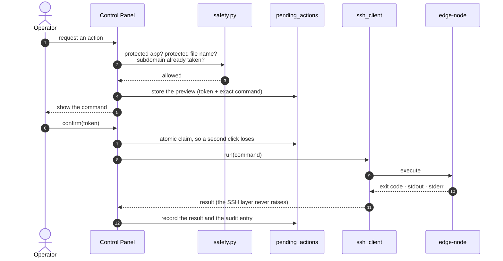
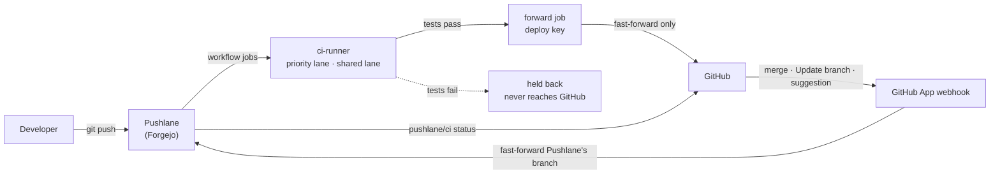

# Homelab Control Plane

**A self-hosted platform on one Proxmox server, built and run by one person.** It has two halves:

- **The Control Panel** deploys a Python web app from a Git repository to a live `https://` URL: clone,
  virtualenv, environment, Redis, systemd units, migrations, dynamic DNS, a Let's Encrypt certificate and an
  nginx vhost. Every privileged step is shown to me as the exact command before it runs.
- **Pushlane** is a private CI service in front of GitHub. Developers push to Pushlane, the tests run on my
  own hardware, and only commits that pass are forwarded to GitHub. Pull requests then show its result as a
  `pushlane/ci` check.

Think "Render plus GitHub Actions, except the hardware is in my house and I wrote the control plane."

<p>


</p>

> **About this repository.** A sanitised, portfolio-facing extract of a private homelab. Hostnames,
> addresses, domains, accounts and every size, count and timing are placeholders or illustrative numbers
> (see [Sanitisation](#sanitisation)); the architecture, the code and the engineering history are real.
> The infrastructure underneath (the host, its guests, storage, network and backups) is mapped in the
> companion repository **[proxmox-homelab](https://github.com/tobioj/proxmox-homelab)**.

---

## At a glance

| | Control Panel | Pushlane CI |
| --- | --- | --- |
| **Job** | Turn a Git repo into a running, monitored `https://` app | Test every push privately; let only green commits reach GitHub |
| **Runs on** | `infra-node` (control plane), deploying to `edge-node` (data plane) | `git-node` (Forgejo server) and `ci-runner` (job VM) |
| **Used through** | A server-rendered web UI | `git push`, the Forgejo web UI, and a JSON API for people and AI agents |
| **Core safety idea** | Preview, confirm, then execute | Forward only on green; isolate every job; never kill a running job |
| **Built with** | FastAPI, SQLite, asyncssh, systemd, nginx, certbot (DNS-01), Redis | Forgejo v15 LTS, forgejo-runner, Docker, a GitHub App |

---

## Contents

- [Why this exists](#why-this-exists)
- [Architecture](#architecture)
- [Part 1: the Control Panel](#part-1-the-control-panel)
- [Part 2: Pushlane CI](#part-2-pushlane-ci)
- [The edge and security](#the-edge-and-security)
- [Engineering log](#engineering-log)
- [Repository layout](#repository-layout)
- [Tech stack](#tech-stack)
- [Known gaps](#known-gaps)
- [Sanitisation](#sanitisation)

---

## Why this exists

**Deploying by hand kept going wrong.** Hosting a Django app at home means SSH, a clone, a virtualenv, a
hand-written systemd unit, remembering which Redis database is free, an nginx vhost, `certbot` with the right
challenge type, and hoping the dynamic DNS still points home. Each step is a chance for a silent mistake,
and several of them happened. The Control Panel exists to remove those specific mistakes and to make every
remaining privileged action reviewable before it runs.

**CI was the next bottleneck.** Hosted CI minutes run out, private code leaves the building, and a broken
commit can reach GitHub before anyone has tested it. Pushlane turns that around: the server tests first,
and GitHub only ever receives commits that passed.

**The principles both halves share:**

| Principle | In practice |
| --- | --- |
| **Nothing runs unreviewed** | Panel actions render their exact command and wait for a click; Pushlane forwards nothing that failed. |
| **Ask, don't guess** | Auto-detection was removed twice after it inferred the wrong thing. The tools list real options; a human picks. |
| **Keep the controller apart from what it controls** | The panel runs on a different VM from the apps it deploys; CI jobs run on a VM of their own. |
| **Least privilege, enforced twice** | Scoped `sudoers` on the target *and* an application-level denylist; CI jobs get no Docker socket and no privileged mode. |
| **State lives in one place** | Reconciliation jobs read the source of truth on every run instead of a hand-kept list. |
| **Restarts are never destructive** | Changing CI capacity waits for running jobs to finish; nothing is killed to apply a setting. |

---

## Architecture





Four guests on one hypervisor, each with one job. The internet reaches exactly one of them, `edge-node`,
through a single forwarded port; everything else sits behind it on the LAN. The full host, storage, network
and backup design is in **[proxmox-homelab](https://github.com/tobioj/proxmox-homelab)**.

---

## Part 1: the Control Panel

The panel lives on `infra-node` and reaches the apps on `edge-node` through one module
(`app/ssh_client.py`), one dedicated key and a narrowly scoped `sudoers` grant. That edge is the only way the
control plane touches the data plane.

### How a deployment happens

A three-phase wizard. Every step is resumable and most are re-runnable; the two that structurally can't be
(a clone into a non-empty directory, a Redis allocation that already happened) have explicit undo actions.



Two details carry most of the weight:

- **Variable names are read from each repository, never assumed.** One project used `DJANGO_ALLOWED_HOSTS`,
  another `ALLOWED_HOSTS`. Writing the wrong one doesn't fail; the framework quietly uses its default and you
  meet it later as a `400 DisallowedHost`. The wizard parses the project's own `.env.example` and writes the
  names *that* project reads.
- **Certificates use DNS-01, because the ISP blocks inbound port 80.** A hook publishes the TXT record through
  the DDNS provider's API and waits until **two independent public resolvers** both see it before letting the
  validation run. One resolver was not enough
  ([incident #1](docs/INCIDENTS.md#1-dns-01-and-the-stale-secondary-resolver)).

### Preview, confirm, execute

No mutating action runs from a request handler. Each becomes a row in `pending_actions`, shown as the literal
command, and runs only when I confirm it.



What that buys:

1. **Commands are built on the server** from validated enums and database values, never from request text.
2. **A double-click can't run something twice.** Issuing a certificate takes up to a minute with no progress
   bar, which invites a second click; the claim is atomic.
3. **Secrets never enter the audit trail.** Writing a `.env` is the one action that isn't a shell command: the
   preview lists variable *names*, and the decrypted values travel only over SFTP.

### Keeping itself right

Three `oneshot` timers reconcile the world against the database, not against a hand-kept list:

| Timer | Every | Reconciles |
| --- | --- | --- |
| DDNS | 5 min | Points every managed app's subdomain at the current WAN IP |
| Uptime | few min | Probes each public URL, records latency and certificate days left, alerts on up/down *transitions* only |
| Renewal | daily | Renews certificates close to expiry, with a random delay |

The DDNS timer replaced a cron script with a hand-typed domain list. When the ISP changed the WAN IP, the apps
on that list followed it and the rest stayed pointed at a dead address
([incident #4](docs/INCIDENTS.md#4-dns-drift-from-a-hand-typed-list)).

Per-app observability is opt-in: enabling it creates the app's error-tracking project, a push-alert topic and
log-shipping credentials, then reports whether the running config is `in_sync`, `saved_not_deployed` or
`deployed_but_different`. The third state caught a hand edit on the server.

**Deep dive:** [docs/ARCHITECTURE.md](docs/ARCHITECTURE.md).

---

## Part 2: Pushlane CI

Pushlane is Forgejo v15 LTS plus the pieces that make it a CI service for a small group: a dedicated runner
VM with two job lanes, a forwarder that pushes only passing commits to GitHub, a GitHub App that brings
GitHub's changes back and reports results, and an API that people and AI agents can drive.



| Capability | How |
| --- | --- |
| **Only green commits reach GitHub** | A managed final job pushes the tested commit with a per-repo deploy key, fast-forward only. A newer push makes an older run skip forwarding, so GitHub never moves backwards. |
| **Two lanes** | A **priority lane** reserved for priority accounts, which never spill onto the shared lane, and a **shared lane** for everyone else. Each has its own slot count, so one heavy user can't starve the rest. |
| **Isolated jobs** | Docker with user-namespace remapping, no privileged mode, no Docker socket, per-job CPU, memory, pid and time limits, and a restrictive firewall on the runner VM. |
| **Graceful capacity changes** | A lane restart stops taking new jobs and waits for running ones, so concurrency can be retuned at any time without killing work. |
| **Shared cache, kept per repository** | One Actions cache server for both lanes: a cache saved on one lane is found on the other, and no repository can read another's entries. |
| **GitHub in both directions** | Merges made on GitHub are fast-forwarded onto Pushlane and tested; every tested commit gets a `pushlane/ci` commit status that branch protection can require. |
| **Built for agents too** | A JSON API for job logs, re-runs and cancels (every call checked by Forgejo with the caller's own token), and an `agents.md` reference whose every command is executed by a test before it is published. |
| **Self-checking** | Each feature has a test that drives the real system with temporary accounts: lanes, the cache, concurrent action fetches, the log API, the agent docs, GitHub sync. |

**Deep dive:** [docs/PUSHLANE-CI.md](docs/PUSHLANE-CI.md).

---

## The edge and security

One VM faces the internet, and it earns that position:

| Layer | What it does |
| --- | --- |
| **Router** | Forwards one port, `443`, to `edge-node`. Nothing else is reachable from outside. |
| **nginx** | TLS for every site, a catch-all vhost that drops unknown hosts with `444`, per-route rate limits (sign-in, API, everything else). |
| **fail2ban** | Bans repeated sign-in failures, rate-limit abuse and scanner probes; repeat offenders are banned for a week. Webhook signature failures answer `403`, not `401`, so the ban rules can never lock out GitHub. |
| **Alerts** | Bans and anomalies go to my phone; a daily digest summarises the last 24 hours and is sent with high priority on unusual days. |
| **Accounts** | Two-factor sign-in for every account, private repositories by default, storage quotas per plan. |
| **Privilege** | The panel escalates only through an explicit `sudoers` allowlist; CI jobs run unprivileged in containers that can't reach the Docker daemon. |

**Deep dive:** [docs/SECURITY-MODEL.md](docs/SECURITY-MODEL.md).

---

## Engineering log

Real failures against real infrastructure. Full write-ups are in [docs/INCIDENTS.md](docs/INCIDENTS.md), and
the CI and infrastructure edge cases are in [docs/PUSHLANE-CI.md](docs/PUSHLANE-CI.md#edge-cases-it-handles)
and [proxmox-homelab](https://github.com/tobioj/proxmox-homelab).

| # | What broke | Why | What I took from it |
| --- | --- | --- | --- |
| 1 | ACME validation saw a *stale* TXT record | Let's Encrypt checks from several vantage points; the DNS provider's nodes hadn't converged | One resolver's view of DNS is not "DNS" |
| 2 | Celery fell back to a default broker | Duplicate keys in `.env`; systemd keeps the **last** one | When a bug class recurs, fix it at a higher altitude |
| 3 | An app connected to `localhost` instead of its database | A value was cut off at `&` when the file was `source`d | Quote every generated value for its strictest reader |
| 4 | Two apps unreachable while every service was healthy | The DNS updater used a hand-typed list | Derive reconciliation input from state |
| 5 | A live app jumped back to an earlier setup step | Fifteen unguarded `UPDATE ... SET step = ...` call sites | A rule that must hold in fifteen places is a function |
| 6 | Redis index allocated past the server's limit | `MAX(index)+1` with no idea of the ceiling, then the fix broke callers | Changing a function's guarantees is a breaking change |
| 7 | A certificate deletion for a certificate that never existed | "A subdomain is recorded" used as proof of "a certificate exists" | Use a field that only the event itself writes |
| 8 | A real vendor key replaced with random bytes | `(^\|_)SECRET_KEY$` also matches `STRIPE_SECRET_KEY` | Test patterns against real third-party names |
| 9 | Scheduler crash loop and login errors | A 5-second scheduler poll kept a serverless database awake until its quota ran out | "Idle" for one component can be constant load for another |

---

## Repository layout

```
.
├── control-panel/                # the deploy tool (sanitised source)
│   ├── app/
│   │   ├── main.py               # FastAPI app, router mounting
│   │   ├── config.py             # settings from the environment
│   │   ├── db.py                 # schema, idempotent migrations, Redis ledger allocator
│   │   ├── auth.py               # session cookies, bcrypt
│   │   ├── crypto.py             # Fernet encryption for secrets at rest
│   │   ├── audit.py              # append-only action log
│   │   ├── ssh_client.py         # the only module that opens SSH; never raises
│   │   ├── actions.py            # preview → confirm → execute pipeline
│   │   ├── safety.py             # protected apps, protected file names, subdomain ownership
│   │   ├── onboarding.py         # the wizard's business logic (the largest module)
│   │   ├── dns_cert.py           # DNS checks, DNS-01 issuance, nginx install, HTTPS check
│   │   ├── lifecycle.py          # pause, resume, recommission, delete
│   │   ├── decommission.py       # ordered shutdown
│   │   ├── github_actions.py     # CI deploy workflow and its dedicated key
│   │   ├── observability.py      # per-app error tracking, logs and alerts
│   │   ├── metrics.py            # per-unit memory, restarts, uptime
│   │   ├── ddns.py · uptime.py · renewal.py   # timer-driven oneshots
│   │   ├── unit_templates/       # Jinja templates for systemd units and vhosts
│   │   ├── routers/              # one module per route group
│   │   └── templates/            # server-rendered HTML (htmx, no SPA)
│   ├── deploy/                   # the panel's own systemd units and timers
│   └── .env.example              # every setting, no values
├── docs/
│   ├── ARCHITECTURE.md           # the Control Panel, component by component
│   ├── PUSHLANE-CI.md            # the CI service: flow, lanes, isolation, GitHub, edge cases
│   ├── DESIGN-DECISIONS.md       # what was chosen, what was rejected, what was reversed
│   ├── SECURITY-MODEL.md         # exposure, privilege boundaries, secrets, the edge
│   ├── INCIDENTS.md              # nine real failures, root-caused
│   └── diagrams/
└── examples/                     # redacted real artefacts
    ├── systemd/  nginx/  sudoers.d/  observability/   # the Control Panel's
    ├── pushlane/                 # CI workflow, a lane's runner config, lane-sync timer, runner firewall
    └── edge/                     # the CI site's nginx config, fail2ban jails and filters
```

Two modules the code imports, `deploy_plan.py` (push-to-deploy) and `deploy_templates.py` (unit and vhost
rendering), are not part of this extract; their behaviour is described in
[ARCHITECTURE.md](docs/ARCHITECTURE.md). Pushlane's own source lives in a private repository; this one documents
its design and ships representative configuration under `examples/pushlane/` and `examples/edge/`.

---

## Tech stack

| Layer | Choice | Why |
| --- | --- | --- |
| Hypervisor | Proxmox VE | Snapshots before risky changes, nightly backups, LXC for light services |
| Control panel | FastAPI + Jinja2 + htmx | Server-rendered; no build step or SPA for a single-operator tool |
| Panel state | SQLite | One file, one writer, trivial to back up |
| Remote execution | `asyncssh` | Async SSH and SFTP in one library |
| Secrets | `cryptography` (Fernet) | Authenticated encryption at rest |
| App runtime | systemd + gunicorn over unix sockets | Apps are reachable only through the proxy |
| Async work | Celery + a shared, ledgered Redis | One database index per role per app |
| Git and CI server | Forgejo v15 LTS | GitHub-compatible workflows, long-term support, self-hosted |
| CI jobs | forgejo-runner + Docker | Two lanes on a dedicated VM, isolated containers |
| GitHub link | Deploy keys + a GitHub App | Forward passing commits; sync merges back; post `pushlane/ci` |
| TLS | Let's Encrypt via DNS-01 | Inbound port 80 is blocked by the ISP |
| Edge | nginx + fail2ban | Rate limits, bans, one public port |
| Observability | Grafana · Loki · GlitchTip · ntfy | Self-hosted, Sentry-compatible, alerts to a phone |

---

## Known gaps

Listed on purpose: a portfolio that only shows the wins isn't useful.

- **`DEBUG` is not switched off automatically.** The `.env` builder writes `DEBUG=True` with a note that the flip
  belongs at the end of go-live. That flip was never implemented, so it is the top item on the list.
- **One of everything.** One hypervisor, one router, one WAN IP, spinning disks. It's a homelab and doesn't
  pretend otherwise; the companion repo shows how backups and recovery cover for it.
- **CI throughput is bound by the disk, not the CPU.** Job concurrency is deliberately low because spinning
  disks saturate long before the processors do. An SSD for the runner is the biggest upgrade available.
- **Job summaries aren't shown.** Forgejo's LTS release doesn't display `GITHUB_STEP_SUMMARY`; staying on LTS
  was a deliberate trade, and the feature arrives with the next LTS.
- **GitHub sync is the newest piece.** It is built and verified at the webhook level; the full end-to-end run
  against a live GitHub repository is the next step.
- **The panel's log viewer polls.** A short `journalctl` snapshot over SSH; streaming would need WebSockets.
- **FastAPI apps are tested by rendering, not in production.** Only Django apps have gone live end to end.

---

## Sanitisation

Generated from the private original by a rewriting pass and checked with a scan for every original identifier.

| Real value | Here |
| --- | --- |
| Hostnames | `hv-01`, `edge-node`, `infra-node`, `git-node`, `ci-runner` |
| Private addresses | `10.10.0.0/24` |
| Public addresses | RFC 5737 documentation ranges (`203.0.113.x`) |
| Domains | `<app>.duckdns.org`, `example-ci.duckdns.org` |
| Application names | `primary-store`, `app-alpha`, `app-beta`, `app-gamma` |
| Accounts and organisations | `operator`, `collaborator-a`, `friend-b`, `example-org` |
| Database host | `ep-example-pooler.REGION.aws.neon.tech` |
| Sizes, counts, timings | Illustrative: they show the shape of the system, not its real capacity |

No credential, token, key, certificate or connection string appears here in any form. `.env` files, databases,
logs and virtualenvs are excluded outright rather than redacted.

---

## License

MIT. See [LICENSE](LICENSE).
