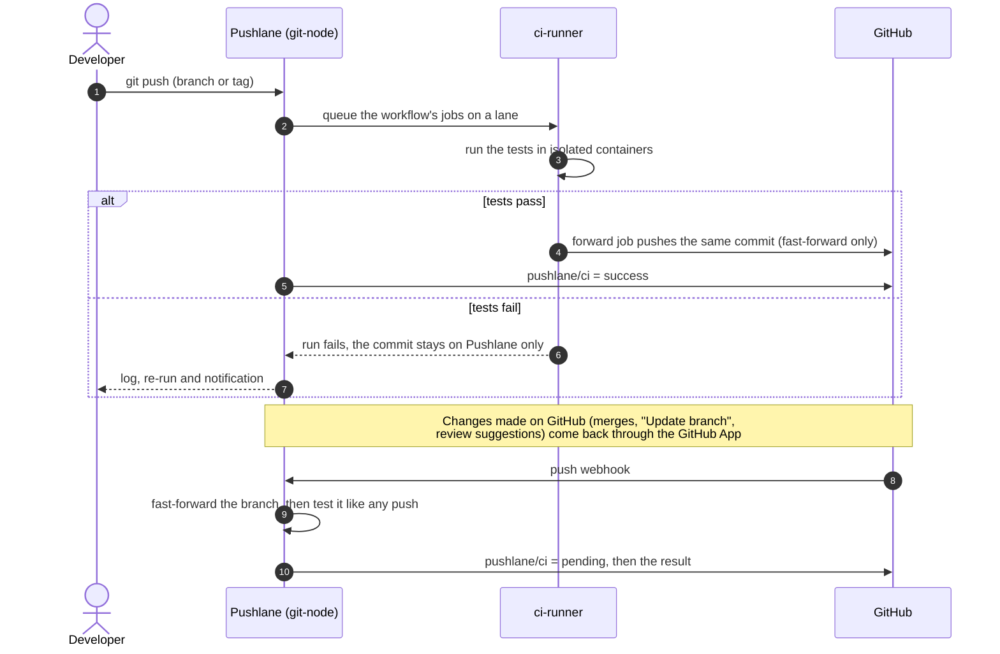

# Pushlane CI

A private CI service for a small, trusted group, running on the same Proxmox host as the Control Panel.
Developers push to Pushlane instead of GitHub; the tests run on my hardware; only commits that pass are
forwarded to GitHub. GitHub never receives an untested commit, hosted CI minutes aren't spent, and private code
stays on private hardware.

It is Forgejo v15 LTS plus five things I built around it: a runner VM with two job lanes, a forwarder, a
GitHub App, an API for people and AI agents, and an admin tool that keeps it all consistent.

---

## Contents

- [The flow](#the-flow)
- [Components](#components)
- [Forwarding: only green commits](#forwarding-only-green-commits)
- [Accounts and plans](#accounts-and-plans)
- [Job lanes](#job-lanes)
- [Job isolation and limits](#job-isolation-and-limits)
- [Caching](#caching)
- [GitHub, both directions](#github-both-directions)
- [For people and AI agents](#for-people-and-ai-agents)
- [Operating it](#operating-it)
- [How it is tested](#how-it-is-tested)
- [Edge cases it handles](#edge-cases-it-handles)
- [Limits](#limits)

---

## The flow



---

## Components

| Component | Where | What it does |
| --- | --- | --- |
| **Forgejo v15 LTS** | `git-node` (LXC) | Git hosting, accounts, the workflow engine, the web UI |
| **Runner lanes** | `ci-runner` (VM) | Two forgejo-runner processes, the priority lane and the shared lane, running jobs in Docker |
| **Actions cache server** | `ci-runner` | One cache shared by both lanes, localhost only, entries kept per repository |
| **Forwarder image** | `ci-runner` | The managed final job: pushes tested commits to GitHub and explains every refusal |
| **Pushlane API** | `git-node` | Job logs, re-run and cancel for people and agents; each call checked by Forgejo with the caller's token |
| **GitHub sync service** | `git-node` | The GitHub App's webhook: copies GitHub's branch updates in and posts `pushlane/ci` statuses |
| **Edge proxy** | `edge-node` | TLS, rate limits and bans in front of all of it |
| **`ci-admin`** | `hv-01` | One admin tool: accounts, plans, lanes, provisioning, health, the GitHub App |
| **Host timers** | `hv-01` | Lane sync every 2 minutes; DDNS every 5 |

---

## Forwarding: only green commits

Every repository's workflow ends with two jobs that Pushlane manages; the user edits only the `test` job
above them ([example](../examples/pushlane/ci-workflow.yml)).

```yaml
  # ---- managed by Pushlane: do not edit below this line ----
  forward-to-github:
    needs: [test]
    runs-on: forwarder
    steps:
      - run: ci-forward
        env:
          GH_REPO: ${{ vars.GH_REPO }}
          GH_DEPLOY_KEY: ${{ secrets.GH_DEPLOY_KEY }}
```

`ci-forward` fetches the tested commit and pushes it to GitHub with that repository's own deploy key:

- **Only the newest commit moves GitHub.** If a newer push to the same branch exists, the older run passes
  without forwarding, so GitHub never moves backwards. A workflow `concurrency` group cancels superseded runs.
- **Fast-forward only.** If GitHub has commits Pushlane lacks, the push is refused instead of overwriting them.
  An explicit, one-time `GH_FORCE_PUSH` variable exists for the rare intended overwrite.
- **Git LFS objects are copied too**, so GitHub never ends up with pointer files only.
- **Every refusal is explained** in words the user can act on:

| GitHub said | The job reports |
| --- | --- |
| `GH006` protected branch | Let the deploy key bypass the rule; the CI server does the checking now |
| `GH013` repository rule | Add deploy keys to the ruleset's bypass list |
| `GH001` file too large | Move the file to Git LFS and push again |
| non-fast-forward | Someone pushed to GitHub directly; pull from GitHub, then push to CI again |
| tag already exists | Tags are never overwritten silently |
| read-only key | Re-add the deploy key with write access |

---

## Accounts and plans

| | Standard (default) | Priority |
| --- | --- | --- |
| Job lane | the shared lane | the priority lane only |
| Storage (repos, LFS, artifacts) | smaller quota | larger quota |
| Repositories | capped | higher cap |

Every account signs in with two-factor authentication, repositories are private by default, and storage is
enforced by Forgejo's quota groups. `ci-admin invite` creates an account and prints a ready-to-send welcome
message; `ci-admin plan USER priority` moves someone between plans, including their runner identity and quota.

---

## Job lanes

The runner VM runs **two lanes**, each a separate forgejo-runner process with its own slot count
(illustrative numbers):

| Lane | Serves | Jobs at once |
| --- | --- | --- |
| Priority | accounts on the priority plan, and only them | 3, shared between them |
| Shared | every other account and organisation | 2 |

**Strict separation.** Priority accounts never run on the shared lane, even when it is idle: if one priority
account fills its lane, the others queue rather than take the shared slots. The shared lane stays free for
everyone else.

**How that is enforced.** Forgejo can't keep an instance-wide runner away from some accounts, so there is no
instance-wide runner at all. Each lane holds one **owner-scoped runner identity per account** it serves, and a
lane sync on the host (every 2 minutes) keeps those lists in step with Forgejo: a new account or organisation
gets the shared lane, a deleted one is dropped, a plan change moves an identity across. An identity a lane
stops using is deleted from Forgejo only once that lane is running a config without it, so no job loses its
connection mid-run.

**Changing capacity never kills a job.** A lane's shutdown timeout equals the job time limit: on restart it
stops taking new jobs, waits for the running ones, then starts with the new config. With small slot counts a
restart costs seconds, because a busy lane couldn't have started anything new anyway.

**Why the numbers are small.** The runner's disk is a spinning drive, and it saturates long before the CPUs
do. Concurrency was cut twice, from 5 + 5 to 3 + 3 and then to 3 + 2, after ten simultaneous jobs with
database services pushed disk pressure to ~70% and Docker stopped answering in time.

---

## Job isolation and limits

| Control | Setting |
| --- | --- |
| Containers | Docker with user-namespace remapping; never `--privileged` |
| Docker socket | Not mounted; `docker build` inside jobs is unsupported by design |
| Host mounts | None allowed (`valid_volumes: []`) |
| Per job | 4 vCPU, 4 GB memory (+1 GB zram swap), a pid limit, 60 minutes (illustrative) |
| Runner VM | Fixed memory (no ballooning) so jobs can't starve other guests; zram as a cushion |
| Network | The hypervisor firewall lets in only SSH from the host. Out, jobs reach the internet, Forgejo's runner port and the edge proxy, and nothing else on the LAN: every private range is dropped, and IP and MAC filters stop the VM from spoofing an address |
| Services | Database `services:` are supported; the docs recommend keeping their data on tmpfs, which starts in seconds |
| Housekeeping | A daily job prunes stopped containers, old images and stale caches, harder when the disk passes 80% |

Labels map familiar names to images (`ubuntu-latest`, `ubuntu-24.04`, `docker`, ...), so most GitHub workflows
run unchanged. Labels that don't exist here (`macos-*`, `windows-*`) are never picked up and are cancelled after
a timeout.

The router can't hairpin traffic back to the public address, so jobs resolve the CI domain to the edge proxy's
LAN address through `--add-host`.

---

## Caching

- **One Actions cache server for both lanes.** `actions/cache` saved on one lane is found on the other. Entries
  are isolated per repository, so no project can read another's cache. The server listens on localhost only and
  every request is signed with a shared secret. Entries are removed after a few weeks unused.
- **Each lane fetches actions into its own folder.** A runner serialises action downloads only between its own
  jobs; two lanes sharing one folder collided (see [edge cases](#edge-cases-it-handles)).
- **Tool versions and dependency caches** follow the usual `setup-node` / `setup-python` patterns, documented
  for users with ready-to-copy recipes.

---

## GitHub, both directions

The forwarder handles Pushlane to GitHub. A **GitHub App** (contents: read, commit statuses: write, push events)
handles the rest:

| Direction | Behaviour |
| --- | --- |
| **GitHub to Pushlane** | When a branch moves on GitHub (a merge, "Update branch", an accepted suggestion, a teammate's push), Pushlane's branch is fast-forwarded to it, or created if it's new, and CI runs on it. Never forced, never deleted: a branch that has diverged is left alone, and the forward job then reports the conflict as before. Tags, deletions and forks are not copied. |
| **Pushlane to GitHub** | Each tested commit gets a `pushlane/ci` status (`pending`, `success`, `failure`, or `error` for a cancelled run) linking to its run, so pull requests show it and branch protection can require it. |

Details that make it safe:

- **The App is created with GitHub's manifest flow.** `ci-admin github-app setup` prints a one-time link; GitHub
  hands the App's id, private key and webhook secret straight to the server. They are never shown on screen.
- **Every webhook is signature-checked** before it is parsed. Failures answer `403`, deliberately not `401`: the
  edge bans addresses after repeated 401s, and that must never hit GitHub's delivery servers.
- **Synced commits are pushed by a dedicated account**, added as a write collaborator, so CI runs on them like
  on any push; forwarding them back is a no-op.
- **Missed webhooks are caught** by a periodic comparison of the branches Pushlane already has. New branches
  arrive only by webhook, so connecting a repository never floods CI with its old branches.
- **Per repository**, `GH_SYNC` chooses `all` (default), `existing` (only update branches Pushlane has) or `off`
  (statuses only).
- **A status needs the commit on GitHub.** A commit pushed to Pushlane first gets its status the moment it is
  forwarded; a commit made on GitHub shows `pending`, then the result. Making `pushlane/ci` required on a branch
  Pushlane forwards to directly means letting the deploy key bypass that rule.

---

## For people and AI agents

| Surface | What it gives |
| --- | --- |
| **Get started page** | A guided setup per project; a "Copy AI setup guide" button produces a Markdown brief, personalised with the server and project, that a user hands to their AI assistant. It never contains a token. |
| **Pushlane API** | `GET …/actions/tasks/{id}/log` (with `tail` and `timestamps`), `POST …/runs/{n}/rerun`, `POST …/runs/{n}/cancel`, and per-project setup progress. Forgejo checks every call with the caller's own token. |
| **`agents.md` and `llms.txt`** | A reference written for agents: setup, logs, re-runs, settings, deploy keys, limits, troubleshooting. Every command in it is executed by a test before publishing, against a temporary account, and checked against the status code the page documents. |
| **Notifications** | Optional per-repository push notifications to a phone when a run finishes. |

Re-run and cancel follow the web page's rules exactly. A re-run needs write access and a write-scoped token,
and only runs once every job of the run has finished. A cancel works while any job is still waiting or running.
Both are rate-limited per caller, and a run can't be re-run twice within a short cooldown.

---

## Operating it

| Command | Purpose |
| --- | --- |
| `ci-admin status` | Forgejo, both lanes and their real capacity, the cache server, the lane sync, the GitHub service, the edge, certificate, disks, memory, last backup |
| `ci-admin invite USER EMAIL [--priority]` | Create an account and print the welcome message |
| `ci-admin plan USER standard\|priority` | Move an account between plans: quota, repository cap, lane |
| `ci-admin apply-lanes` | Apply new jobs-at-once settings; each lane switches once its running jobs finish |
| `ci-admin sync-lanes` | Bring both lanes' account lists in step with Forgejo (also run by the timer) |
| `ci-admin provision-runner` / `rebuild-runner` | Update the runner VM in place, or rebuild it from scratch |
| `ci-admin github-app setup\|status` | Create the GitHub App; list connected repositories |
| `ci-admin plan-cleanup` | After a rename or delete in the web UI: keep a renamed account's plan and logs, drop a deleted one's |

---

## How it is tested

Each test drives the real system with temporary accounts and removes everything it created:

| Test | Proves |
| --- | --- |
| `lane-test` | Each lane serves exactly the right accounts; a priority job waits for a priority slot while the shared lane sits idle; neither lane exceeds its slots |
| `cache-test` | A cache saved on one lane is restored on the other; other repositories, of the same owner or another, never see it |
| `action-fetch-test` | Jobs starting at the same instant on both lanes fetch the same actions cleanly; `--same-folder` reproduces the old collision on throwaway runners |
| `logs-api-test` | Log access, re-run and cancel permissions, cooldowns, a run marked failed while a job still runs, logs that survive an account rename |
| `agents-doc-test` | Every command in the published `agents.md` runs and returns the status the page promises |
| `github-test` (new) | Forwarding plus `pushlane/ci`; commits made on GitHub copied in and tested; diverged branches left alone; deletions ignored; each `GH_SYNC` mode |
| `smoke-test` | End to end: push, pass and fail, forward |

---

## Edge cases it handles

| Situation | What could go wrong | How it is handled |
| --- | --- | --- |
| Jobs on both lanes fetch the same action at the same moment | Two runner processes collide in one cache folder (`shallow.lock: File exists`) and jobs fail before any step runs | Each lane has its own action folder; git's background cleanup runs inside the lane's lock. Reproduced first: about a third of jobs collided with one shared folder, none in 24 with separate folders. |
| Many jobs with database services start together | The spinning disk saturates, Docker answers too slowly, health checks and copies time out | Lower concurrency, databases on tmpfs, and an agent-facing troubleshooting row that says it's the server, not the project |
| A registered account is deleted in the web UI | A lane whose config names a dead identity refuses to start | The lane config is built only from identities Forgejo still has; the sync drops the rest |
| Capacity changes while jobs run | A restart would kill them | Graceful drain: the lane waits for its jobs (up to the job time limit) before switching |
| An account is renamed | Job logs are filed under the old name; plan and lane would be lost | Logs are found by their unique task id; the plan and runner identity follow the account id |
| A job name contains `—`, accents or emoji | HTTP headers must be Latin-1; the log API returned 502 | Header values are normalised to ASCII |
| One job fails while others still run | The run already shows `failure`; a naive re-run is refused and cancel looks pointless | Re-run and cancel look at the run's jobs, not just its status, and explain what to do |
| A newer push lands while an older run is testing | The older commit could overwrite the newer one on GitHub | The forwarder checks it is still the branch's newest commit before pushing |
| GitHub retries a webhook with a bad signature | Repeated rejections could trigger an IP ban | Signature failures are `403`, which the ban rules ignore |
| The router can't hairpin | Jobs can't reach the CI's public name from inside the LAN | Jobs resolve it to the edge proxy's LAN address |
| A workflow writes a job summary | Forgejo LTS doesn't display it | Documented as harmless; the summary is discarded |

---

## Limits

- Throughput is bound by the runner's spinning disk; concurrency stays low on purpose.
- Job summaries aren't displayed until the next Forgejo LTS.
- Git LFS files added on GitHub aren't copied back by the sync.
- `docker build` inside jobs isn't supported: jobs never get the Docker socket.
- One runner VM: if it is down, jobs queue until it's back (it can be rebuilt from scratch in minutes).
